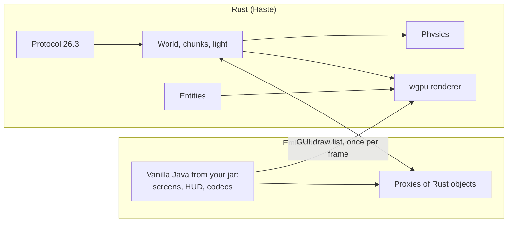

<div align="center">

# Haste

**A fast Minecraft: Java Edition client, written in Rust.**

Plays like vanilla wherever you can feel it. Built from the start to run Fabric mods.

[](https://github.com/bednarjosef/haste/actions/workflows/ci.yml)
[](LICENSE)
[](#getting-started)
[](rust-toolchain.toml)
[](#progress)

</div>

---

Haste is a from-scratch client for **Minecraft: Java Edition 26.3**. The world, physics,
networking and rendering are native Rust; the game's own Java code still runs the menus and
screens, loaded at runtime from your own copy of the game. The aim is a client you cannot tell
apart from vanilla, that runs faster than vanilla with Sodium, and that will later host Fabric
mods through a compatibility layer.

> [!NOTE]
> Haste is in active development. Phase 1 (a complete vanilla client) is about **90 %** done:
> you can play singleplayer and on offline-mode servers today. Online-mode servers (Microsoft
> login) are not supported yet, and mods come in Phase 2.

## Highlights

- **Faithful.** Movement and collision, input timing, hand and camera animations, the HUD,
  sound timing and every packet the client sends are ported from the vanilla 26.3 source with
  the same constants, math and order of steps, so that neither you nor the server can tell
  the difference. Visuals are compared pixel by pixel against the real game.
- **Fast.** A [wgpu](https://wgpu.rs) renderer (Vulkan, Metal, DX12) with meshing off the render
  thread, batched draws and no per-frame allocation. Every rendering change is benchmarked
  before it lands.
- **Built for mods.** Game objects live in Rust with one stable Java proxy each; menus,
  codecs and value types stay real vanilla Java. Phase 2 will add Mixin handlers at Rust
  landmarks so Fabric mods can run unmodified.
- **Your game, nothing redistributed.** `haste setup` downloads 26.3 from Mojang onto your
  machine. No Mojang code, assets or data are in this repository.

## Getting started

You need [Rust](https://rustup.rs) (the pinned stable toolchain installs itself from
`rust-toolchain.toml`) and a GPU with Vulkan, Metal or DX12. On Linux, install the ALSA
headers (`libasound2-dev` or your distribution's equivalent).

```bash
git clone https://github.com/bednarjosef/haste
cd haste
cargo run --release --bin haste -- setup   # once: game files, Java 25 runtime, data generator
cargo run --release --bin haste            # title screen: Singleplayer, Multiplayer, Options
```

Join a server directly or start a local world from the command line:

```bash
cargo run --release --bin haste -- --server host:port --username Steve
cargo run --release --bin haste -- singleplayer --world test
```

Controls and options are vanilla's, saved in vanilla's `options.txt`. `haste setup` uses a Java
25 runtime if one is installed, otherwise it downloads Temurin 25 into the cache. Everything
downloaded or derived from Mojang's files stays in `cache/` (or `$HASTE_CACHE`).

## Progress

**51 of 65 done, 13 partly done, 1 not started** (about 88 %, counting partly done as
half). The list is what a player needs to play Haste like the original game without noticing
a difference; Phase 2 (mods) is not counted.

`██████████████████████████░░░░` **88 %**

| Area | Progress | ✅ | 🟡 | ⬜ |
|---|---|---:|---:|---:|
| Launching and setup | `█████████░` | 9 | 2 | 0 |
| Connecting to servers | `████████░░` | 3 | 2 | 0 |
| World | `██████████` | 5 | 0 | 0 |
| Rendering | `████████░░` | 13 | 6 | 1 |
| HUD and screens | `██████████` | 12 | 0 | 0 |
| Playing | `█████████░` | 6 | 2 | 0 |
| Sound | `██████░░░░` | 1 | 3 | 0 |

✅ done: works in the game today, checked against a real server.
🟡 partly done: some of it works, but a player cannot use all of it yet.
⬜ not started.

<details>
<summary><b>Launching and setup</b> — 9 of 11 done</summary>

- ✅ Install the game files (`haste setup`): downloads 26.3 from Mojang and runs the data generator; a second run is instant
- ✅ Options screens: vanilla's options screen and every sub-screen open from the pause menu (checked by script)
- ✅ Saved options: vanilla's options.txt; changes in the options screens apply live (FOV, render distance, sensitivity, max FPS, vsync, GUI scale, volumes)
- ✅ Title screen: vanilla's title screen is shown when `haste` starts
- ✅ Singleplayer: the world list, Create New World and Save and Quit to Title, played through a local server (checked by script); `haste singleplayer --world NAME` also works
- ✅ Server list: vanilla's multiplayer screen with the saved servers, status pings, Add Server and Direct Connection
- ✅ Joining a server: from the server list or Direct Connection, or `haste --server host:port`
- ✅ Languages: every language of the game, switched live from Options > Language
- ✅ Keybind remapping: Options > Controls > Key Binds rebinds any key, saved in options.txt and kept across restarts (checked by script)
- 🟡 Microsoft account login: `haste login` / `haste logout` run the device-code flow, refresh the token and store the account; the whole chain is tested against a local mock of Microsoft's servers, a run with a real Microsoft app id is still to do
- 🟡 Resource packs: the Resource Packs screen picks, orders and applies packs live, saved in options.txt; packs sent by servers download, are checked and applied above yours; the accept/decline prompt not yet

</details>

<details>
<summary><b>Connecting to servers</b> — 3 of 5 done</summary>

- ✅ Offline-mode vanilla and Fabric servers: join and stay connected on normal terrain, every packet decodes
- ✅ Configuration phase, server transfers, cookies, resource pack answers
- ✅ Item data: stacks decode and round-trip, and names, enchantments, damage, rarity and tool rules read into typed values; block breaking uses the held stack's `minecraft:tool` component and Efficiency, the attack strength delay its `minecraft:attack_speed` modifiers, and item use duration its `minecraft:consumable` (verified against vanilla's tick counts, `scripts/checks/item-data-check.sh`)
- 🟡 Online-mode servers: encryption, vanilla's session hash and the session join are done and unit-tested against Java's results; a live run needs the Microsoft login above
- 🟡 Signed chat (required by online-mode servers): chat session, message signing and the seen-messages window match vanilla (unit-tested); used once online mode works

</details>

<details>
<summary><b>World</b> — 5 of 5 done</summary>

- ✅ Terrain: chunks, light, block and multi-block updates, chunk loading and unloading
- ✅ Biomes and their grass, foliage and water colours
- ✅ Dimensions: Overworld, Nether, End, respawn and dimension changes
- ✅ Block entities (chests, signs, banners, ...): stored with their chunks and kept up to date
- ✅ Day and night, sun, moon, stars, clouds, rain, snow and thunder, with weather fog and lightning

</details>

<details>
<summary><b>Rendering</b> — 13 of 20 done</summary>

- ✅ Textured blocks and block models
- ✅ Water and lava with flow direction and corner heights
- ✅ Block selection outline and break cracks
- ✅ Fullscreen (F11)
- ✅ Animated textures (water, lava, fire, portals), prepared off the render thread
- ✅ Third-person view (F5)
- ✅ First-person hand and held item (hidden in third person)
- ✅ Dropped items, item frames and paintings drawn as themselves, with vanilla's bob, spin and stack copies
- ✅ Fog: vanilla's distance fog, colours, sky disc and sunrise, and the water, lava, powder snow, Nether, End, blindness and darkness fog
- ✅ Screen effects: damage tilt, red flash on hit entities, vignette, underwater, fire, in-wall, pumpkin, powder snow, spyglass, portal and nausea
- ✅ Entity animation: walking, head and body turning, attack swings, aggressive arms, death tilt, sleeping, swimming and mob-specific poses
- 🟡 Armour, held items, heads and elytra on mobs and players; horse armour, wolf armour and saddles not yet
- ✅ Mobs and players: vanilla's models for all 91 mob types with babies, variants, sizes and states, default skins, name tags and shadows
- 🟡 Particles: the server's and the client's own (breaking, mining cracks, sprinting, landing, torches, fire, lava, portals, drips); 19 types move, size and fade like vanilla, the other ~110 use a default behaviour
- ✅ Smooth lighting and ambient occlusion: ported from vanilla, shaded in vanilla's colour space; forest scenes match the vanilla reference shots within about 3/255 per channel
- 🟡 Performance: in the same window and spot as vanilla (1408x828, render distance 12) about 1.3x its frame rate and 1.7x less memory (807 MB against 1.35 GB); not yet compared with Sodium
- 🟡 Block entities drawn: chests, ender chests, shulker boxes, signs, banners, heads, lecterns, enchanting tables with their turning book, bells, decorated pots, conduits, campfire items, spawners, vaults, shelves, brushable blocks, beacon beams, end portals and gateways and moving pistons; the newest ones not yet checked on screen
- 🟡 Player skins and capes: vanilla's default skins, skins and capes downloaded from the profile, slim and wide arms, the skin layers and the cape's swing; not yet checked on screen
- 🟡 Non-mob entities drawn as themselves: minecarts, boats, chest boats, rafts, thrown items (snowballs, eggs, pearls, potions, fireballs), falling blocks, primed TNT and armour stands (poses, small stands, armour and held items) done; arrows, the fishing bobber and firework rockets still boxes (being ported)
- ✅ Maps, held in one or both hands and in item frames, drawn from the server's map data

</details>

<details>
<summary><b>HUD and screens</b> — 12 of 12 done</summary>

These run as the game's own Java code inside Haste, with keyboard and mouse input. Checked with input scripts (`haste --script`, `scripts/checks/`) against a vanilla server.
- ✅ HUD: hotbar, health, hunger, armour, air, experience
- ✅ Chat: typing and sending (the server relays the message)
- ✅ Pause menu
- ✅ Player list (Tab), boss bars, scoreboard sidebar, titles and action bar
- ✅ Player inventory and crafting grid, with the player model
- ✅ Death screen and respawn
- ✅ Debug screen (F3): vanilla's default entries with real values (checked against the server)
- ✅ Creative inventory: every tab's items and search
- ✅ Advancements and statistics screens, and every other pause-menu button
- ✅ Recipe book: open it, search, click a recipe to craft (checked by script)
- ✅ Containers: chests, crafting table, furnace, anvil, enchanting table, brewing stand and villager trading, each checked in game against the server
- ✅ Editing signs, books and command blocks (checked in game)

</details>

<details>
<summary><b>Playing</b> — 8 of 8 done</summary>

- ✅ Walking, sprinting, sneaking, jumping, swimming, creative flight and fall damage, accepted by the vanilla server without corrections
- ✅ Breaking and placing blocks, using items, attacking, pick block, hotbar (mouse wheel and 1-9)
- ✅ Dropping items (Q, Ctrl+Q) and swapping to the off-hand (F)
- ✅ Game modes: survival, creative, spectator (through walls) and adventure
- ✅ Screenshot key (F2): saves to the screenshots folder
- ✅ Elytra flight: gliding started from the game, firework boost (the server sees a normal glide)
- ✅ Riding: vanilla seat positions; steering boats, horses, pigs (carrot on a stick) and striders (warped fungus on a stick, walking on lava) like vanilla, with the mount's hearts and the horse jump bar
- ✅ Climbing ladders, vines and scaffolding: vanilla's climbing physics, with the climbable blocks taken from the server's block tags

</details>

<details>
<summary><b>Sound</b> — 1 of 4 done</summary>

- ✅ Sounds of your own footsteps, mining, breaking, placing and falling, with vanilla's step distance and sound variants
- 🟡 3D sound: distance falloff and stereo panning from the player's eye; entity sounds do not follow a moving entity yet
- 🟡 Sound effects: the server's sounds play in the window (block, entity and stopped sounds, per-category volumes); not yet checked by ear
- 🟡 Music: plays by situation (game, creative, underwater) with vanilla's pauses; not yet checked by ear

</details>

## How it works



Game state lives in three tiers:

1. **Rust** owns everything stateful and hot: the world, chunks, entities, physics and the
   connection.
2. **Proxies** expose those objects to Java, one canonical proxy per object for its whole
   lifetime, so mods can keep state on them.
3. **Vanilla Java** runs everything without hot state (screens, widgets, chat, codecs,
   registries) straight from the player's game jar. GUI drawing is batched into one draw list
   per frame, never one call per widget.

## Repository layout

| Crate | What it does |
|---|---|
| [`haste-client`](crates/haste-client) | The `haste` binary: window, game loop, input |
| [`haste-protocol`](crates/haste-protocol) | The 26.3 protocol, packets, encryption, authentication |
| [`haste-world`](crates/haste-world) | Chunks, palettes, light, block updates |
| [`haste-physics`](crates/haste-physics) | Vanilla-exact movement and collision |
| [`haste-entity`](crates/haste-entity) | Entity tracking, interpolation, models and animation |
| [`haste-render`](crates/haste-render) | The wgpu renderer, meshing, particles, GUI drawing |
| [`haste-assets`](crates/haste-assets) | Reading textures, models, fonts and resource packs |
| [`haste-audio`](crates/haste-audio) | Sound and music |
| [`haste-jvm`](crates/haste-jvm) | The embedded JVM, proxy generator and GUI bridge |
| [`haste-data`](crates/haste-data) | Registries, block states and item data from the game's data generator |
| [`haste-setup`](crates/haste-setup) | Downloads, the data generator, options, the local singleplayer server |
| [`haste-testkit`](crates/haste-testkit) | Golden-data formats, replays, screenshot diffs, benchmarks |
| [`haste-core`](crates/haste-core) | Shared types and the interfaces between crates |

`tools/recorder-mod` is a Fabric mod that records reference data from the real game, and
`phase2/` holds the spike code for the mod compatibility layer.

## Development

```bash
scripts/ci-local.sh                                         # the CI checks, only for what your branch changed
cargo test --workspace                                      # fast tests
cargo clippy --workspace --all-targets -- -D warnings       # what CI runs
cargo run --release --bin haste -- --server host:port --bench 20   # offscreen benchmark
```

Tests that need the game files are ignored until `haste setup` has filled the cache; in-game
checks live in `scripts/checks/` and run against a real server. Read [AGENTS.md](AGENTS.md)
before contributing: vanilla behaviour is looked up in the game's own code, never guessed, and
the rules for performance and mod-readiness apply to every change.
[docs/ROADMAP.md](docs/ROADMAP.md) has the plan and [docs/TESTING.md](docs/TESTING.md) the test
tiers.

## License

Haste is free software under the [GNU General Public License v3.0 or later](LICENSE).
Third-party code it reuses is listed with its license in [THIRD_PARTY.md](THIRD_PARTY.md).

Haste is not an official Minecraft product and is not approved by or associated with Mojang
or Microsoft. You need your own copy of Minecraft: Java Edition to play.
