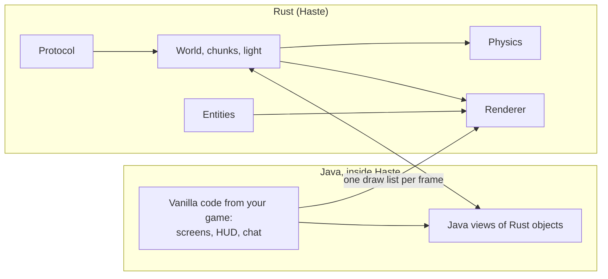

<div align="center">

# Haste

**A fast Minecraft: Java Edition client, written in Rust.**

[](LICENSE)
[](#getting-started)
[](rust-toolchain.toml)

</div>

Haste is a new client for **Minecraft: Java Edition 26.3**. The world, physics, networking,
rendering and sound are written in Rust. The menus and screens are the game's own Java code,
loaded from your copy of the game. The goals:

- **Plays exactly like vanilla.** Anything you can see, hear or feel, and every packet the
  server sees, is ported from the game's own code: same constants, same math, same order.
- **Faster than vanilla.** A [wgpu](https://wgpu.rs) renderer (Vulkan, Metal, DX12) that does
  its heavy work off the render thread.
- **Runs Fabric mods** later, through a compatibility layer (Phase 2, not started).

## Status

Haste is in development. **What works today:** singleplayer, and offline-mode servers (vanilla
or Fabric). You can explore, build, fight, ride, use every menu and container, and change the
options as in vanilla.

**What does not work yet:**

- **Online-mode servers**, which means most public servers. The Microsoft login and the server
  encryption are written and tested offline, but Haste ships no Microsoft app id, so you cannot
  log in yet.
- **Mods.** That is Phase 2.
- **A few things in game are missing or still placeholders:**
  - guardian lasers and the End crystal and dragon beams are not drawn;
  - End crystals, wind charges and shulker bullets are drawn as boxes;
  - the server dialog screens added in 26.3 do not open;
  - most particle types (all but about 35 of vanilla's ~128) move with a default behaviour
    instead of their own;
  - sounds from a moving mob stay where they started.
- **Not yet checked by eye or ear:** player skins and capes, the newest block entities, and
  sound effects and music.

### Progress

The checklist below is what a player needs to play Haste in place of the vanilla game; mods are
not counted. A partly done item counts as half. The percentage is a rough guide: one item can
be a small feature or, like online-mode servers, a large one.

**54 of 67 done, 11 partly done, 2 missing: about 89 %.**

| Area | Done | Partly | Missing | |
|---|---:|---:|---:|---:|
| Launching and menus | 7 | 1 | 0 | 94 % |
| Servers | 3 | 2 | 0 | 80 % |
| World | 5 | 0 | 0 | 100 % |
| Rendering | 13 | 5 | 1 | 82 % |
| HUD and screens | 15 | 0 | 1 | 94 % |
| Playing | 9 | 0 | 0 | 100 % |
| Sound | 2 | 3 | 0 | 70 % |

<details>
<summary><b>The full checklist</b></summary>

✅ done · 🟡 partly done · ⬜ missing

**Launching and menus**
- ✅ `haste setup` downloads the game from Mojang and prepares its data
- ✅ Title screen, singleplayer world list, Create New World, Save and Quit
- ✅ Server list with status pings, Add Server and Direct Connection
- ✅ Options screens; options are saved in vanilla's `options.txt` and apply live
- ✅ Key binds can be changed and are kept
- ✅ Every language, switchable live
- ✅ Resource packs: your own, and server packs with the accept/decline prompt
- 🟡 Microsoft login: works against a stand-in for Microsoft's servers; no real app id yet

**Servers**
- ✅ Offline-mode vanilla and Fabric servers
- ✅ Configuration phase, server transfers, cookies
- ✅ Item data: names, enchantments, damage, tool and attack speed rules
- 🟡 Online-mode servers: written and unit-tested; needs the Microsoft login
- 🟡 Signed chat: written and unit-tested; needs online mode

**World**
- ✅ Terrain: chunks, light, block updates, loading and unloading
- ✅ Biome colours for grass, foliage and water
- ✅ Overworld, Nether and End; respawning and changing dimension
- ✅ Block entities (chests, signs, banners, ...) kept up to date
- ✅ Day and night, sun, moon, stars, clouds, rain, snow, thunder and lightning

**Rendering**
- ✅ Blocks and block models, animated textures
- ✅ Water and lava
- ✅ Smooth lighting and ambient occlusion, matching vanilla's shots within about 3/255
- ✅ Fog in every dimension and fluid, sky colours and sunrise
- ✅ Block outline and breaking cracks
- ✅ First-person hand and held item; third-person view (F5); fullscreen (F11)
- ✅ Screen effects: hurt tilt, vignette, underwater, fire, pumpkin, spyglass, portal, nausea
- ✅ All mobs and players with vanilla's models, variants, babies and animations
- ✅ Armour, held items, heads and elytra; horse and wolf armour, saddles, llama carpets
- ✅ Enchantment glint on items and armour
- ✅ Dropped items, item frames, paintings and maps
- ✅ Leashes
- ✅ The world border wall and its warning vignette
- 🟡 Other entities: boats, minecarts, arrows, tridents, thrown items, fireworks, falling
  blocks, TNT, armour stands, fishing bobbers and display entities are drawn; End crystals,
  wind charges and shulker bullets are still boxes
- 🟡 Particles: all are shown; about 35 types move like vanilla, the rest use a default
- 🟡 Block entities: chests, signs, banners, heads, beacons, end portals and more; the newest
  are not yet checked on screen
- 🟡 Player skins and capes: done, not yet checked on screen
- 🟡 Speed: see [Performance](#performance); not yet compared with Sodium
- ⬜ Beams: the guardian laser and the End crystal and dragon beams

**HUD and screens** (vanilla's own Java code, running inside Haste)
- ✅ HUD: hotbar, health, hunger, armour, air, experience
- ✅ Item cooldowns on the hotbar
- ✅ Chat
- ✅ Subtitles
- ✅ Pause menu, and every button on it
- ✅ Player list, boss bars, scoreboard, titles and action bar
- ✅ Inventory and crafting
- ✅ Creative inventory with search
- ✅ Recipe book
- ✅ Containers: chests, crafting table, furnace, anvil, enchanting, brewing, trading
- ✅ Editing signs, books and command blocks
- ✅ Advancements and statistics
- ✅ Death screen and respawn
- ✅ Debug screen (F3)
- ✅ Spectator menu
- ⬜ Server dialogs (new in 26.3)

**Playing**
- ✅ Walking, sprinting, sneaking, jumping, swimming, flying and fall damage, accepted by the
  server without corrections
- ✅ Breaking and placing blocks, using items, attacking, pick block, hotbar
- ✅ Dropping items and swapping hands
- ✅ Survival, creative, adventure and spectator, including watching through another entity
- ✅ Elytra flight with firework boosts
- ✅ Riding boats, minecarts, horses, pigs and striders
- ✅ Climbing ladders, vines and scaffolding
- ✅ Explosion knockback
- ✅ Screenshots (F2)

**Sound**
- ✅ Your own footsteps, mining, breaking, placing and falling
- ✅ Ambient sound: caves, underwater and biome loops
- 🟡 3D sound: distance and stereo work; sounds from moving mobs do not follow them
- 🟡 Sound effects from the server: they play, not yet checked by ear
- 🟡 Music: plays by situation, not yet checked by ear

</details>

### Performance

Measured on 2026-10-20 on a laptop (Radeon 860M on power saver, 1408x828 window), at the same
spot as vanilla:

| Render distance | Haste median frame | Vanilla median frame | Memory |
|---|---|---|---|
| 32 | 4.1-4.8 ms | 7.9 ms | 2.8x less (716 MB against 2.0 GB) |
| 12 | within noise of vanilla | about the same | 2.7x less |

## Getting started

You need [Rust](https://rustup.rs) and a GPU with Vulkan, Metal or DX12. On Linux, also install
the ALSA headers (`libasound2-dev` or your distribution's equivalent).

```bash
git clone https://github.com/bednarjosef/haste
cd haste
cargo run --release --bin haste -- setup   # once: downloads the game and a Java 25 runtime
cargo run --release --bin haste            # opens the title screen
```

You can also join a server or open a world directly:

```bash
cargo run --release --bin haste -- --server host:port --username Steve
cargo run --release --bin haste -- singleplayer --world test
```

Controls and options are vanilla's. Everything downloaded from Mojang stays in `cache/` (or
`$HASTE_CACHE`); none of it is in this repository.

## How it works



- **Rust** owns everything with live game state: the world, entities, physics, the connection.
- **Java views** give the game's Java code access to those Rust objects, one view per object
  for its whole lifetime, so mods can later keep their own data on them.
- **Vanilla Java** from your game runs everything else: screens, widgets, chat, data formats.
  Its drawing is collected into one list per frame.

## Repository layout

| Crate | What it does |
|---|---|
| [`haste-client`](crates/haste-client) | The `haste` program: window, game loop, input |
| [`haste-protocol`](crates/haste-protocol) | Network protocol, packets, encryption, login |
| [`haste-world`](crates/haste-world) | Chunks, light, block updates |
| [`haste-physics`](crates/haste-physics) | Movement and collision |
| [`haste-entity`](crates/haste-entity) | Entities, their models and animations |
| [`haste-render`](crates/haste-render) | The renderer, particles, GUI drawing |
| [`haste-assets`](crates/haste-assets) | Textures, models, fonts, resource packs |
| [`haste-audio`](crates/haste-audio) | Sound and music |
| [`haste-jvm`](crates/haste-jvm) | The embedded Java runtime and the bridge to it |
| [`haste-data`](crates/haste-data) | Block, item and registry data from the game |
| [`haste-setup`](crates/haste-setup) | Downloads, options, the local singleplayer server |
| [`haste-testkit`](crates/haste-testkit) | Test data formats, screenshot comparison, benchmarks |
| [`haste-core`](crates/haste-core) | Shared types |

`tools/recorder-mod` is a Fabric mod that records reference data from the real game.
`phase2/` holds the experiments for mod support.

## Development

```bash
scripts/ci-local.sh                                     # checks for what your branch changed
cargo test --workspace
cargo clippy --workspace --all-targets -- -D warnings
```

Tests that need the game files are skipped until `haste setup` has run. In-game checks live in
`scripts/checks/`. Read [AGENTS.md](docs/AGENTS.md) before contributing: vanilla behaviour is looked
up in the game's code, never guessed.

## License

Haste is free software under the [GNU General Public License v3.0 or later](LICENSE). Code it
reuses from other projects is listed in [THIRD_PARTY.md](THIRD_PARTY.md).

Haste is not an official Minecraft product and is not approved by or associated with Mojang or
Microsoft. You need your own copy of Minecraft: Java Edition to play.
